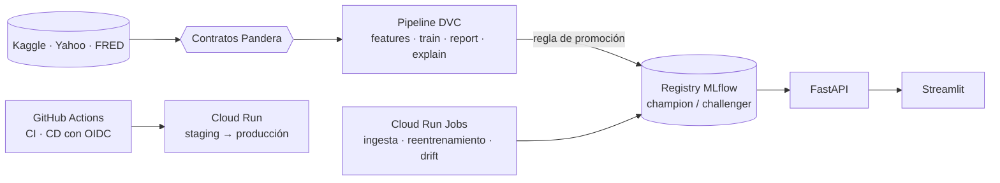

# Clasificador de la dirección del Brent

> ¿Puede el machine learning predecir si el Brent cerrará al alza mañana? Un sistema de ML de extremo a
> extremo que responde **que no**, lo demuestra estadísticamente y está diseñado para no desplegar un
> modelo que solo ha tenido suerte.

[](https://github.com/rafaelhh04/PrediccionPetroleo-Clasificacion/actions/workflows/ci.yml)
[](https://codecov.io/gh/rafaelhh04/PrediccionPetroleo-Clasificacion)
[](https://www.python.org/)
[](LICENSE)

*English version (completa): [README.md](README.md).*

## En resumen

- **La pregunta.** ¿Subirá mañana el Brent? Compiten cinco modelos sobre 16 años de datos diarios de
  mercado y geopolítica:
  - regresión logística;
  - SVM RBF;
  - random forest;
  - LightGBM ajustado con Optuna;
  - un **perceptrón multicapa escrito desde cero en NumPy**.
- **La respuesta: ninguno supera a lanzar una moneda, y el sistema lo demuestra.** Se usa validación
  walk-forward purgada frente a cuatro baselines ingenuos, con intervalos *block bootstrap*, tests de
  DeLong con corrección de Holm y un backtest con costes. Todos los intervalos de AUC contienen 0.5.
  Con los datos originales de Kaggle, las AUC de test fueron 0.486–0.500.
- **Por eso se despliega el baseline.** Un modelo solo pasa a `champion` si supera al mejor baseline *con
  significancia*. Ninguno lo consigue, así que el registry sirve la persistencia («mañana repite hoy») y
  el mejor modelo queda como `challenger`.
- **Alrededor, una plataforma de nivel profesional.**
  - Reproducibilidad y datos: DVC + MLflow y contratos Pandera.
  - Serving: FastAPI + Streamlit con Prometheus, y Docker.
  - Cloud: Terraform para Cloud Run y CD sin claves (staging, revisión candidata con smoke test,
    rollback).
  - Operación: reentrenamiento semanal y alertas de drift con Evidently.
  - Calidad: más de 660 tests con un 97.8 % de cobertura de ramas.

> [!IMPORTANT]
> **Cifras sintéticas.** Kaggle, Yahoo Finance y FRED no eran accesibles desde el entorno de desarrollo.
> Salvo las AUC originales de Kaggle citadas arriba, todas las métricas, capturas y gráficos vienen de un
> **paseo aleatorio sintético** con el esquema de Kaggle, en el que por construcción no hay nada que
> predecir. Muestran la maquinaria de evaluación, no el mercado del Brent.


## Inicio rápido

Requiere [uv](https://docs.astral.sh/uv/getting-started/installation/) y `make`. No hacen falta
credenciales.

```bash
git clone https://github.com/rafaelhh04/PrediccionPetroleo-Clasificacion.git && cd PrediccionPetroleo-Clasificacion
make demo                    # instala, datos sintéticos, entrena, informe + campeón, SHAP (~6 min)
make -j2 serve dashboard     # API en http://127.0.0.1:8000/docs, dashboard en http://127.0.0.1:8501
```

`make demo` usa la capa rápida [`configs/demo.yaml`](configs/demo.yaml), que mantiene el protocolo y
reduce los espacios de búsqueda. Otras formas de ejecutarlo:

- **Datos reales:** `uv run brent data download` (credenciales de Kaggle) y `uv run dvc repro`.
- **Contenedores:** con datos en `data/raw/` (descargados o sintéticos),
  `docker compose --profile train run --rm trainer && docker compose up -d`.

## Arquitectura



El diagrama completo y cada capa se describen en el [README en inglés](README.md#architecture).

## Decisiones de ingeniería clave

- **Walk-forward purgado** (purga de 1 día, embargo de 5) con todo el preprocesado dentro de cada
  `Pipeline`. Hay tests de truncamiento que prueban que ninguna feature mira al futuro.
- **Los baselines son candidatos de pleno derecho.** Para promocionar un modelo hacen falta un DeLong-Holm
  con p < 0.05 *y* un intervalo bootstrap de ΔAUC por encima de cero.
- **Incertidumbre antes que estimaciones puntuales:** *block bootstrap* de 21 días emparejado y un
  backtest con 5 pb por operación.
- **MLP desde cero en NumPy**, con API de scikit-learn y *gradient check* numérico (error ≤ 2.5e-9).
- **Una única ruta de predicción** (CLI, API y drift). El contrato es la firma MLflow + Pandera, y un
  snapshot de OpenAPI detecta cambios incompatibles.
- **Cloud barato y sin claves**, ~0 €/mes:
  - Cloud Run escala a cero y GCS FUSE monta las mismas rutas que compose.
  - MLflow corre sobre SQLite con un único escritor (Cloud SQL opcional).
  - El despliegue usa WIF y un único digest de staging a producción.
- **Operar, no solo desplegar.** El reentrenamiento semanal es idempotente y aplica la misma regla de
  promoción; el drift diario se analiza con Evidently y alerta por webhook.

## Documentación

- Guías (en inglés):
  - [uso](docs/guide/usage.md);
  - [metodología](docs/guide/methodology.md);
  - [MLOps](docs/guide/mlops.md);
  - [serving](docs/guide/serving.md);
  - [cloud](docs/guide/cloud.md);
  - [resultados](docs/guide/results.md).
- [Model card](docs/MODEL_CARD.md).
- [Infraestructura](infra/README.md).
- [Roadmap y notas de cierre de cada fase](docs/ROADMAP.md).
- [Cómo contribuir](CONTRIBUTING.md).

## Desarrollo

```bash
make install     # uv sync --frozen + hooks de pre-commit
make lint        # ruff, codespell, mypy --strict
make test        # suite rápida (`make test-all` añade los end-to-end lentos)
make coverage    # cobertura de ramas, falla por debajo del 85 %
```

## Limitaciones conocidas

- **Resultados sintéticos**: falta ejecutar la pipeline con los datos reales.
- **Sin URL pública todavía**: la infraestructura está validada sin credenciales. Desplegarla requiere un
  proyecto de GCP ([infra/README.md](infra/README.md)).
- **Datos en vivo**: no hay fuente en vivo para el índice de riesgo geopolítico ni para los eventos.
- **Backtest**: ignora el roll de futuros, la financiación y el slippage variable.

## Autor y licencia

Rafael Hernando Herias. Empezó como proyecto individual de la asignatura de Machine Learning (2025-26).
Licencia [MIT](LICENSE).
