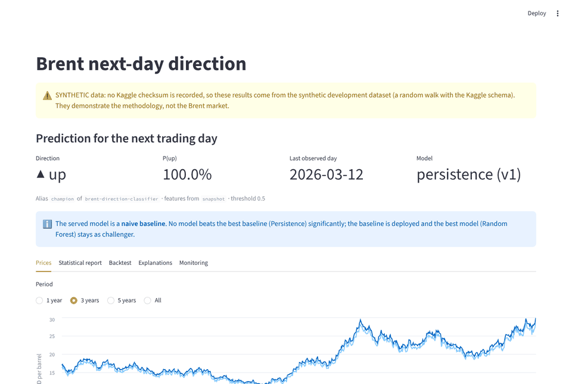
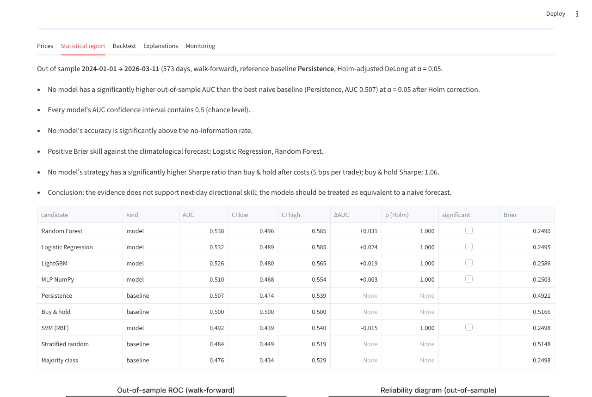
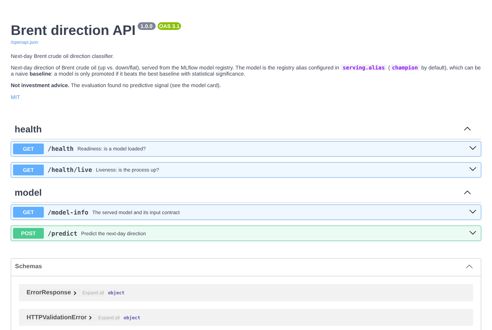
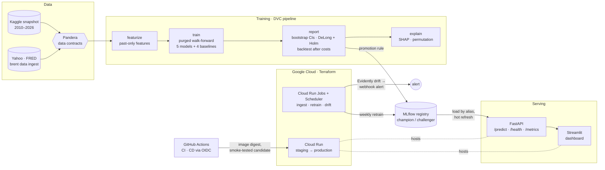

# Brent Direction Classifier

> Can machine learning predict whether Brent crude closes higher tomorrow? An end-to-end ML system that
> answers **no**, proves it statistically, and is engineered to refuse deploying a model that is
> merely lucky.

[](https://github.com/rafaelhh04/PrediccionPetroleo-Clasificacion/actions/workflows/ci.yml)
[](CHANGELOG.md)
[](https://codecov.io/gh/rafaelhh04/PrediccionPetroleo-Clasificacion)
[](https://www.python.org/)
[](LICENSE)
[](https://docs.astral.sh/uv/)
[](https://docs.astral.sh/ruff/)
[](https://mypy.readthedocs.io/)
[](infra/README.md)
[](https://rafaelhh04.github.io/PrediccionPetroleo-Clasificacion/)

*Versión en español: [README.es.md](README.es.md).* · **Article:** [Why 4 models can't beat a coin flip
on Brent — and how to prove it](docs/blog/why-models-cant-beat-a-coin-flip.md)

## TL;DR

- **The question.** Will Brent close higher tomorrow? Five models compete on 16 years of daily market and
  geopolitical data: logistic regression, an RBF SVM, a random forest, LightGBM tuned with Optuna and a
  **multilayer perceptron written from scratch in NumPy**.
- **The answer: no model beats a coin flip, and the system proves it.** Every model is scored with a
  purged walk-forward protocol against four naive baselines. The scoring uses block-bootstrap
  confidence intervals, DeLong tests with Holm correction and a backtest after costs. Every AUC
  interval contains 0.5. On the original Kaggle data the test AUCs were 0.486–0.500.
- **So the baseline ships.** A model is promoted to `champion` only when it beats the best baseline
  *with significance*. None does, so the registry serves the persistence baseline ("tomorrow repeats
  today") and the best model waits as `challenger`. Shipping an overfitted model is the failure mode
  this project was built to prevent.
- **Around that result, a production-grade platform.**
  - Reproducible pipeline: DVC + MLflow.
  - Data contracts: Pandera.
  - Serving: FastAPI + Streamlit with Prometheus metrics.
  - Platform: Docker, Terraform for Cloud Run, and keyless CD with staging, a smoke-tested candidate
    revision and rollback.
  - Operations: weekly retraining and daily Evidently drift alerts.
  - Quality: 660+ tests at 97.8 % branch coverage, run on Python 3.12 and 3.13.

> [!IMPORTANT]
> **Synthetic numbers.** Kaggle, Yahoo Finance and FRED were unreachable from the development
> environment. Apart from the original Kaggle AUCs quoted above, every metric, screenshot and plot in
> this repository comes from a **synthetic random walk** with the Kaggle schema. On such data there is,
> by construction, nothing to predict. The numbers demonstrate the evaluation machinery, not the Brent
> market. The dashboard and every report label their provenance.

## Demo



| Statistical report (`make demo`, synthetic data) | Interactive API docs |
|---|---|
|  |  |

## Quickstart

Requires [uv](https://docs.astral.sh/uv/getting-started/installation/) (it installs Python 3.12) and
`make`. No credentials and no network access to data sources are needed.

```bash
git clone https://github.com/rafaelhh04/PrediccionPetroleo-Clasificacion.git && cd PrediccionPetroleo-Clasificacion
make demo                    # install, synthetic data, train, statistical report + champion, SHAP (~6 min)
make -j2 serve dashboard     # API on http://127.0.0.1:8000/docs, dashboard on http://127.0.0.1:8501
```

`make demo` uses the fast [`configs/demo.yaml`](configs/demo.yaml) overlay, which keeps the protocol and
shrinks the search spaces. Other ways to run it:

- **Real data:** `uv run brent data download` (Kaggle credentials), then `uv run dvc repro`.
- **Containers:** with data in `data/raw/` (downloaded or synthetic),
  `docker compose --profile train run --rm trainer && docker compose up -d`.

The [usage guide](docs/guide/usage.md) covers every command.

## Architecture



| Layer | What it does | Details |
|-------|--------------|---------|
| Data | Kaggle download with SHA-256 checksums, live ingestion, Pandera contracts at every boundary | [Usage](docs/guide/usage.md#data), [Methodology](docs/guide/methodology.md#data-contracts-pandera) |
| ML | Leakage-safe features, scikit-learn pipelines, purged walk-forward CV, Optuna, NumPy MLP | [Methodology](docs/guide/methodology.md) |
| Evaluation | Baselines, block bootstrap, DeLong + Holm, calibration, backtest, SHAP | [Methodology](docs/guide/methodology.md#statistical-evaluation), [Results](docs/guide/results.md) |
| MLOps | DVC stages and lock, MLflow tracking and registry, promotion rule | [MLOps](docs/guide/mlops.md) |
| Serving | FastAPI with an OpenAPI snapshot contract, Prometheus metrics, structured logs, Streamlit, Docker | [Serving](docs/guide/serving.md) |
| Cloud | Terraform (two stacks), Cloud Run, keyless CD, scheduled retraining, drift monitoring | [Cloud](docs/guide/cloud.md), [infra/README.md](infra/README.md) |

## Key engineering decisions

- **Purged walk-forward evaluation, not a random split.** Each model is refitted every 63 trading days on
  strictly older rows, with a 1-day purge and a 5-day embargo. VIF selection, winsorisation and scaling
  are pipeline steps refitted in every fold. Truncation tests prove that no feature reads the future.
- **Baselines are first-class candidates.** Majority class, persistence, stratified random and buy & hold go
  through exactly the same protocol. The promotion rule needs a Holm-adjusted DeLong p < 0.05 *and* a
  bootstrap interval of ΔAUC above zero. Otherwise the baseline is the champion.
- **Uncertainty over point estimates.** Daily returns are serially dependent, so intervals come from a
  circular block bootstrap (21-day blocks), paired across candidates. The backtest pays 5 bps per trade.
- **A neural network from scratch.** Backpropagation, inverted dropout, He initialisation and early
  stopping in NumPy, behind the scikit-learn estimator API. A numerical gradient check bounds the error at
  ≤ 2.5e-9.
- **One prediction path.** `brent predict`, the API and the drift job share `predict_features`. The input
  contract is the MLflow signature plus Pandera. An OpenAPI snapshot test catches breaking API changes.
- **Cheap, keyless cloud.**
  - Cloud Run scales to zero; GCS FUSE mounts give the containers the same paths as docker compose.
  - MLflow runs on SQLite in the bucket with a single writer; Cloud SQL is one variable away.
  - GitHub Actions deploys through Workload Identity Federation (no JSON keys), one image digest from
    staging to production. A candidate revision is smoke-tested before it gets traffic.
  - Estimated cost: **~0 €/month**.
- **Operate, don't just deploy.** Weekly retraining is idempotent: it is skipped when data, config and
  code are unchanged. It applies the same promotion rule, and the API picks up a new champion without a
  restart. Daily drift reports with Evidently alert through a webhook.

Each decision has an [architecture decision record](docs/adr/index.md) with its context, alternatives and
consequences; the closing notes of every phase in [docs/ROADMAP.md](docs/ROADMAP.md) add the details.

## Results at a glance

**Statistical report on the synthetic dataset** (not real data). Full run, out-of-sample period
2024-01-01 to 2026-03-11, with 95 % block-bootstrap intervals; the reference baseline is persistence
(AUC 0.507):

| Model | OOS AUC [95 % CI] | ΔAUC vs persistence [95 % CI] | p (Holm) | Sharpe (B&H 1.06) |
|-------|-------------------|-------------------------------|---------:|------------------:|
| Logistic regression | 0.532 [0.485, 0.581] | +0.024 [−0.031, +0.078] | 1.000 | 1.16 |
| SVM (RBF) | 0.492 [0.441, 0.539] | −0.015 [−0.072, +0.041] | 1.000 | −0.68 |
| Random forest | 0.519 [0.473, 0.562] | +0.011 [−0.043, +0.062] | 1.000 | 0.96 |
| MLP (NumPy) | 0.510 [0.465, 0.556] | +0.003 [−0.058, +0.061] | 1.000 | 0.87 |
| LightGBM (Optuna) | 0.512 [0.467, 0.560] | +0.005 [−0.051, +0.059] | 1.000 | 1.17 |

Every AUC interval contains 0.5, no model beats persistence and no Sharpe ratio beats buy & hold
significantly. The winner's curse shows up too: the SVM had the best development-period AUC (0.514) and is
the worst model out of sample (0.492). Full tables,
backtest and feature ablation are in [Results](docs/guide/results.md); intended use, risks and caveats
are in the [model card](docs/MODEL_CARD.md).

## Documentation

Everything below is also published as a searchable site with the API reference:
**[rafaelhh04.github.io/PrediccionPetroleo-Clasificacion](https://rafaelhh04.github.io/PrediccionPetroleo-Clasificacion/)** (MkDocs Material). The
link goes live once GitHub Pages is enabled ([CONTRIBUTING.md](CONTRIBUTING.md#documentation-site-github-pages)).

| Document | Content |
|----------|---------|
| [Usage](docs/guide/usage.md) | Installation, data, every CLI command, outputs, configuration |
| [Methodology](docs/guide/methodology.md) | Features, models, baselines, validation, statistics, data contracts, explainability |
| [MLOps](docs/guide/mlops.md) | DVC pipeline, MLflow tracking and registry, live data and prediction |
| [Serving](docs/guide/serving.md) | API, observability, dashboard, containers, load test |
| [Cloud, CD and monitoring](docs/guide/cloud.md) | GCP stack, continuous deployment, retraining, drift |
| [Results](docs/guide/results.md) | Statistical report, backtest, feature ablation |
| [Article](docs/blog/why-models-cant-beat-a-coin-flip.md) | *Why 4 models can't beat a coin flip on Brent — and how to prove it*: methodology, tests, backtest, lessons |
| [Model card](docs/MODEL_CARD.md) | Intended use, metrics with intervals, limitations, risks |
| [Architecture decisions](docs/adr/index.md) | Eight ADRs: src layout + uv, purged walk-forward, promotion rule, MLflow backend, GCS FUSE, keyless CD, drift, demo |
| [API reference](docs/reference/index.md) | Generated from the docstrings with mkdocstrings (best read on the site) |
| [Infrastructure](infra/README.md) | Terraform stacks, diagrams, deployment steps, costs |
| [Roadmap](docs/ROADMAP.md) | Professionalisation plan, progress log and closing notes per phase (Spanish) |
| [Changelog](CHANGELOG.md) | Every change since the original course project, generated from the commits |
| [Contributing](CONTRIBUTING.md) | Workflow, conventions, CI, releases, repository settings |

## Project structure

```text
├── src/brent_forecast/
│   ├── cli.py                  # Typer CLI (`brent`)
│   ├── config.py               # typed settings (pydantic-settings, layered YAML + BRENT_* env vars)
│   ├── data/                   # Kaggle download + checksums, loading, Pandera schemas, live ingestion
│   ├── features/               # label, past-only features, VIF / winsorisation transformers
│   ├── models/                 # model registry, NumPy MLP, baselines, grid and Optuna tuning
│   ├── validation/             # purged walk-forward splitter
│   ├── evaluation/             # metrics, statistics, backtest, report, SHAP / permutation
│   ├── pipeline.py             # end-to-end training orchestration
│   ├── tracking.py             # MLflow runs, registry, promotion rule
│   ├── predict.py              # next-day prediction (CLI, API and drift job)
│   ├── retrain.py · notify.py  # scheduled retraining and webhook notifications
│   ├── monitoring/             # data and prediction drift (Evidently)
│   ├── api/                    # FastAPI service, observability
│   ├── dashboard/              # Streamlit demo
│   └── synthetic.py            # synthetic dataset for demos and tests
├── tests/                      # unit, leakage-guard, gradient-check, property, API-contract tests
├── configs/                    # default.yaml, demo.yaml overlay, data checksums
├── infra/                      # Terraform: bootstrap (state, registry, WIF) + Cloud Run stack
├── .github/workflows/          # CI, CD (staging → production), rollback
├── Dockerfile · docker-compose.yml
├── dvc.yaml · dvc.lock         # reproducible pipeline
└── docs/                       # guides, model card, roadmap, assets
```

## Development

```bash
make install     # uv sync --frozen + pre-commit hooks
make lint        # ruff, codespell, mypy --strict, file hygiene
make test        # fast suite; `make test-all` adds the slow end-to-end tests
make coverage    # branch coverage, fails under 85 %
make docs        # documentation site, warnings as errors (`make docs-serve` for live reload)
make help        # every target
```

CI runs lint and types, the tests on Python 3.12 and 3.13, a Docker build with smoke tests and a Trivy
gate, Terraform checks (fmt, validate, test, tflint, Trivy IaC), the strict docs build and actionlint. The conventions
(Conventional Commits, one branch per feature, English for code and docs) are described in
[CONTRIBUTING.md](CONTRIBUTING.md).

## Known limitations

- **Synthetic results.** Real data still has to be run through the pipeline; see the
  [model card](docs/MODEL_CARD.md#reproducing).
- **No public URL yet.** The cloud stack is validated without credentials (`terraform test` with mocked
  providers, a CD dry run). Deploying it needs a GCP project ([infra/README.md](infra/README.md)).
- **Live data gaps.** No live source exists for the geopolitical risk index or the events. Futures closes
  stand in for spot prices.
- **Backtest scope.** It ignores the futures roll, financing and variable slippage.
- **Image size.** The API image carries the training stack (~390 MB compressed). Splitting the serving
  and training images is a planned follow-up.

## Author

Rafael Hernando Herias. This started as an individual Machine Learning course project (2025-26) and was
turned into a production-style system phase by phase ([roadmap](docs/ROADMAP.md)).

## License

[MIT](LICENSE)
