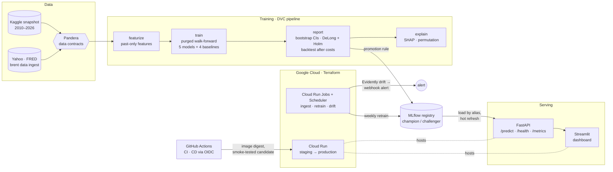

# Brent Direction Classifier

Can machine learning predict whether Brent crude closes higher tomorrow? This site documents an
end-to-end ML system that answers **no**, proves it statistically, and is engineered to refuse deploying
a model that is merely lucky.

[Read the article](blog/why-models-cant-beat-a-coin-flip.md){ .md-button .md-button--primary }
[Source on GitHub](https://github.com/rafaelhh04/PrediccionPetroleo-Clasificacion){ .md-button }

## TL;DR

- **The question.** Will Brent close higher tomorrow? Five models compete on 16 years of daily market and
  geopolitical data: logistic regression, an RBF SVM, a random forest, LightGBM tuned with Optuna and a
  **multilayer perceptron written from scratch in NumPy**.
- **The answer: no model beats a coin flip, and the system proves it.** Every model is scored with a
  purged walk-forward protocol against four naive baselines. The scoring uses block-bootstrap
  confidence intervals, DeLong tests with Holm correction and a backtest after costs. Every AUC
  interval contains 0.5. On the original Kaggle data the test AUCs were 0.486–0.500.
- **So the baseline ships.** A model is promoted to `champion` only when it beats the best baseline
  *with significance*. None does, so the registry serves the persistence baseline ("tomorrow repeats
  today") and the best model waits as `challenger`. Shipping an overfitted model is the failure mode
  this project was built to prevent.
- **Around that result, a production-grade platform.**
    - Reproducible pipeline: DVC + MLflow.
    - Data contracts: Pandera.
    - Serving: FastAPI + Streamlit with Prometheus metrics.
    - Platform: Docker, Terraform for Cloud Run, and keyless CD with staging, a smoke-tested candidate
    revision and rollback.
    - Operations: weekly retraining and daily Evidently drift alerts.
    - Quality: 660+ tests at 97.8 % branch coverage, run on Python 3.12 and 3.13.

!!! warning "Synthetic numbers"
    Kaggle, Yahoo Finance and FRED were unreachable from the development
    environment. Apart from the original Kaggle AUCs quoted above, every metric, screenshot and plot in
    this repository comes from a **synthetic random walk** with the Kaggle schema. On such data there is,
    by construction, nothing to predict. The numbers demonstrate the evaluation machinery, not the Brent
    market. The dashboard and every report label their provenance.

## Demo


| Statistical report (`make demo`, synthetic data) | Interactive API docs |
|---|---|
|  |  |

## Quickstart

Requires [uv](https://docs.astral.sh/uv/getting-started/installation/) (it installs Python 3.12) and
`make`. No credentials and no network access to data sources are needed.

```bash
git clone https://github.com/rafaelhh04/PrediccionPetroleo-Clasificacion.git && cd PrediccionPetroleo-Clasificacion
make demo                    # install, synthetic data, train, statistical report + champion, SHAP (~6 min)
make -j2 serve dashboard     # API on http://127.0.0.1:8000/docs, dashboard on http://127.0.0.1:8501
```

`make demo` uses the fast [`configs/demo.yaml`](https://github.com/rafaelhh04/PrediccionPetroleo-Clasificacion/blob/main/configs/demo.yaml) overlay, which keeps the protocol and
shrinks the search spaces. Other ways to run it:

- **Real data:** `uv run brent data download` (Kaggle credentials), then `uv run dvc repro`.
- **Containers:** with data in `data/raw/` (downloaded or synthetic),
  `docker compose --profile train run --rm trainer && docker compose up -d`.

The [usage guide](guide/usage.md) covers every command.

## Architecture



| Layer | What it does | Details |
|-------|--------------|---------|
| Data | Kaggle download with SHA-256 checksums, live ingestion, Pandera contracts at every boundary | [Usage](guide/usage.md#data), [Methodology](guide/methodology.md#data-contracts-pandera) |
| ML | Leakage-safe features, scikit-learn pipelines, purged walk-forward CV, Optuna, NumPy MLP | [Methodology](guide/methodology.md) |
| Evaluation | Baselines, block bootstrap, DeLong + Holm, calibration, backtest, SHAP | [Methodology](guide/methodology.md#statistical-evaluation), [Results](guide/results.md) |
| MLOps | DVC stages and lock, MLflow tracking and registry, promotion rule | [MLOps](guide/mlops.md) |
| Serving | FastAPI with an OpenAPI snapshot contract, Prometheus metrics, structured logs, Streamlit, Docker | [Serving](guide/serving.md) |
| Cloud | Terraform (two stacks), Cloud Run, keyless CD, scheduled retraining, drift monitoring | [Cloud](guide/cloud.md), [infra/README.md](https://github.com/rafaelhh04/PrediccionPetroleo-Clasificacion/blob/main/infra/README.md) |

## Key engineering decisions

- **Purged walk-forward evaluation, not a random split.** Each model is refitted every 63 trading days on
  strictly older rows, with a 1-day purge and a 5-day embargo. VIF selection, winsorisation and scaling
  are pipeline steps refitted in every fold. Truncation tests prove that no feature reads the future.
- **Baselines are first-class candidates.** Majority class, persistence, stratified random and buy & hold go
  through exactly the same protocol. The promotion rule needs a Holm-adjusted DeLong p < 0.05 *and* a
  bootstrap interval of ΔAUC above zero. Otherwise the baseline is the champion.
- **Uncertainty over point estimates.** Daily returns are serially dependent, so intervals come from a
  circular block bootstrap (21-day blocks), paired across candidates. The backtest pays 5 bps per trade.
- **A neural network from scratch.** Backpropagation, inverted dropout, He initialisation and early
  stopping in NumPy, behind the scikit-learn estimator API. A numerical gradient check bounds the error at
  ≤ 2.5e-9.
- **One prediction path.** `brent predict`, the API and the drift job share `predict_features`. The input
  contract is the MLflow signature plus Pandera. An OpenAPI snapshot test catches breaking API changes.
- **Cheap, keyless cloud.**
    - Cloud Run scales to zero; GCS FUSE mounts give the containers the same paths as docker compose.
    - MLflow runs on SQLite in the bucket with a single writer; Cloud SQL is one variable away.
    - GitHub Actions deploys through Workload Identity Federation (no JSON keys), one image digest from
    staging to production. A candidate revision is smoke-tested before it gets traffic.
    - Estimated cost: **~0 €/month**.
- **Operate, don't just deploy.** Weekly retraining is idempotent: it is skipped when data, config and
  code are unchanged. It applies the same promotion rule, and the API picks up a new champion without a
  restart. Daily drift reports with Evidently alert through a webhook.

Each decision has an [architecture decision record](adr/index.md); the trade-offs are also discussed in [infra/README.md](https://github.com/rafaelhh04/PrediccionPetroleo-Clasificacion/blob/main/infra/README.md#design-decisions) and in the
closing notes of every phase in [docs/ROADMAP.md](https://github.com/rafaelhh04/PrediccionPetroleo-Clasificacion/blob/main/docs/ROADMAP.md).
