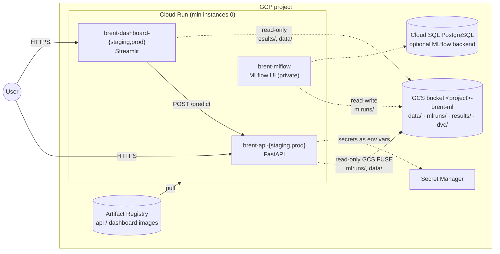

# Infrastructure (GCP, Terraform)

Everything the Brent direction classifier needs on Google Cloud, as code. The defaults keep the
monthly bill at **~0 €** for a portfolio demo (see [Cost](#cost)).



## Layout

| Path | What | State |
|------|------|-------|
| [`bootstrap/`](bootstrap) | Project APIs, Terraform state bucket (versioned), Artifact Registry repository (immutable tags, cleanup policy). Applied once by a project owner. | local (can be migrated to GCS) |
| [`./`](.) | ML bucket, service accounts, Secret Manager, Cloud Run services (API and dashboard per environment, MLflow UI), optional Cloud SQL, optional budget alert. | GCS (`<project>-tfstate`, prefix `brent-forecast/main`), locked |
| [`tests/`](tests) | `terraform test` with mocked providers: plan-level assertions (scale to zero, read-only mounts, Cloud SQL toggle) without credentials. | — |

One file per concern: `storage.tf`, `iam.tf`, `secrets.tf`, `services.tf`, `mlflow.tf`,
`budget.tf`. No modules: each resource exists once (or once per environment with `for_each`),
so a module would only add indirection.

### Bucket layout

The services mount bucket folders with [Cloud Storage volume mounts](https://cloud.google.com/run/docs/configuring/services/cloud-storage-volume-mounts)
(GCS FUSE) at the **same paths as in `docker-compose.yml`**, because MLflow records absolute
artifact locations (`file:///app/mlruns/artifacts/...`): a model registered by the training job
resolves in the API and in the MLflow UI.

| Prefix | Content | Mounted by |
|--------|---------|------------|
| `data/raw/`, `data/live/` | Raw snapshot and `brent data ingest` output | API, dashboard (read-only) |
| `mlruns/` | `mlflow.db` (SQLite backend) and `artifacts/` | API (read-only), MLflow UI (read-write) |
| `results/` | Reports, plots, explanations | dashboard (read-only) |
| `dvc/` | DVC remote (content-addressed cache) | — (`dvc push`/`pull`) |

Versioning is on: an overwritten `mlflow.db` or a bad run can be restored from an earlier object
generation. The lifecycle keeps the last 3 earlier versions of each object for at most 30 days and
aborts incomplete uploads; soft delete is off because versioning already covers it.

## Design decisions

- **Scale to zero, request-based billing.** Every service has `min_instance_count = 0` and
  `cpu_idle = true`: an idle demo costs nothing; the first request after a while pays a cold
  start of a few seconds (imports and model load; `startup_cpu_boost` shortens it).
- **API sizing from the load test** (Phase 5, one uvicorn process): p95 72 ms at ~10 req/s,
  saturation at ~40 req/s because of the GIL. At that rate ~3 requests are in flight (Little's
  law, 40 × 0.07 s), so **concurrency 8** absorbs bursts without long queues behind the GIL;
  beyond it Cloud Run adds an instance (max 2: a cost cap). **1 vCPU** (one process cannot use
  more), **1 GiB** (~290 MiB resident after imports, plus the model, pandas and the GCS FUSE
  daemon, whose memory counts against the instance). Timeout 30 s (a prediction takes < 100 ms).
- **Liveness ≠ readiness.** Startup and liveness probes use `/health/live`: before the first
  champion is registered `/health` answers 503 and the service must stay up (it reloads the model
  by itself). The CD smoke test is what requires `/health` = 200.
- **Least privilege.** One service account per workload; bucket roles on the bucket only
  (`objectViewer` for the API and the dashboard, `objectUser` for MLflow), secret access per
  secret, `cloudsql.client` only with the Cloud SQL backend. No JSON keys anywhere.
- **The image is owned by CD, not by Terraform.** Terraform creates the services with
  `var.image_tag` and then ignores the image (`lifecycle.ignore_changes`): a later `apply` never
  rolls back a deployment. Infrastructure and releases change independently.
- **Read-only registry in the API.** The API loads the model from a local copy of a pinned
  version, so the bucket can be mounted read-only (MLflow writes metadata next to the artifacts it
  loads from a `models:/` URI).
- **MLflow UI never public.** It has no authentication and can edit the registry: invoker only for
  `var.mlflow_ui_members`, opened with `gcloud run services proxy brent-mlflow`.

### MLflow backend store: SQLite on GCS vs. Cloud SQL

| | `mlflow_backend = "sqlite"` (default) | `mlflow_backend = "cloudsql"` |
|---|---|---|
| Store | `mlruns/mlflow.db` on GCS FUSE | PostgreSQL 17, `db-f1-micro`, HDD, daily backups |
| Cost | ~0 € (a few MB in the bucket) | ~9–10 USD/month (instance + 10 GB + backups) |
| Concurrency | **One writer at a time**: GCS has no file locks and each write rewrites the whole object. The MLflow server is capped at 1 instance; the scheduled job is the only other writer. | Many concurrent writers |
| Durability | Object versioning (restore an earlier generation) | Point-in-time backups |
| Fits | A portfolio with one scheduled training job | A team, several jobs, an always-on UI |

The switch is one variable: the backend URI (with a generated password) is stored in Secret
Manager and injected as `BRENT_TRACKING__URI` / `MLFLOW_BACKEND_STORE_URI`; the services connect
through the Cloud SQL connector (`/cloudsql` volume, mutual TLS, no authorized networks). The
images include `psycopg2-binary` (extra `postgres`). Moving an existing SQLite store to PostgreSQL
is a one-off `mlflow db upgrade` + export/import, not covered here.

## Deploy, step by step

Prerequisites: a GCP project with billing, `gcloud` and Terraform ≥ 1.10, Docker.

```bash
export PROJECT_ID=my-project REGION=us-central1
gcloud auth login && gcloud auth application-default login
gcloud config set project "$PROJECT_ID"

# 1. Foundation (once): APIs, state bucket, image repository.
cd infra/bootstrap
terraform init
terraform apply -var project_id="$PROJECT_ID" -var region="$REGION"

# 2. First images (later pushes come from CI, see .github/workflows/).
REPO=$(terraform output -raw image_repository)
TAG=$(git rev-parse HEAD)
gcloud auth configure-docker "$REGION-docker.pkg.dev"
docker build -t "$REPO/api:$TAG" ../.. && docker push "$REPO/api:$TAG"
docker build --target dashboard -t "$REPO/dashboard:$TAG" ../.. && docker push "$REPO/dashboard:$TAG"

# 3. Main stack, state in GCS (locked).
cd ..
terraform init -backend-config="bucket=$PROJECT_ID-tfstate"
cp terraform.tfvars.example terraform.tfvars   # set project_id, image_tag=$TAG, ...
terraform plan -out=main.tfplan && terraform apply main.tfplan

# 4. Data for the services (plain files; the DVC remote is gs://<bucket>/dvc).
BUCKET=$(terraform output -raw bucket)
gcloud storage rsync --recursive ../data/raw "gs://$BUCKET/data/raw"
uv run dvc remote add -d gcs "gs://$BUCKET/dvc" && uv run --with dvc-gs dvc push   # optional

terraform output api_urls dashboard_urls
```

Until a champion is registered the API answers `/health` → 503 (and keeps retrying). The registry
can be created by the scheduled training job or, for a first look, by training locally inside the
compose stack and copying the `mlruns` volume to `gs://<bucket>/mlruns/` (the paths match).

Optional: move the bootstrap state into the bucket it created:

```bash
cd infra/bootstrap
cat > backend_override.tf <<'EOF'
terraform {
  backend "gcs" {
    prefix = "brent-forecast/bootstrap"
  }
}
EOF
terraform init -migrate-state -backend-config="bucket=$PROJECT_ID-tfstate"
```

(`*_override.tf` files are not committed: the bootstrap stays usable with local state.)

**Tear down:** `terraform destroy` in `infra/` and then in `infra/bootstrap/` (with
`deletion_protection = false`, the default; the state bucket is never force-destroyed).

## Checks without credentials

```bash
make infra-check   # terraform fmt -check, validate (both stacks, no backend) and terraform test
```

CI (`infra` job) runs the same with pinned images plus **tflint** (terraform + google rulesets)
and **Trivy IaC** (fails on MEDIUM or above, for both MLflow backends). Accepted findings are
annotated in place with the reason: Google-managed bucket encryption keys (`AVD-GCP-0066`, LOW)
and the Cloud SQL public IP without authorized networks (`AVD-GCP-0017`).

## Cost

Estimated for the demo traffic of a portfolio (hundreds of requests a month), list prices of
`us-central1` and the free tiers of a billing account:

| Resource | Usage | Free tier | Estimate |
|----------|-------|-----------|----------|
| Cloud Run services (6 + MLflow) | scale to zero, request-based | 180k vCPU-s, 360k GiB-s, 2M requests / month | 0 € |
| Artifact Registry | 2 images × up to 10 versions; shared base layers | 0.5 GB | 0–0.30 €/month (0.10 USD/GB above the free tier) |
| Cloud Storage | data + MLflow store + results (< 1 GB) | 5 GB Standard (us-central1/us-east1/us-west1) | 0 € |
| Secret Manager | 1–2 secrets, few accesses | 6 versions, 10k accesses | 0 € |
| Terraform state | a few KB | (same 5 GB) | 0 € |
| Cloud SQL (opt-in) | db-f1-micro + 10 GB HDD + backups | none | ~9–10 USD/month |
| **Total (defaults)** | | | **~0 €/month** |

Set `billing_account` to get an e-mail budget alert at 50/90/100 % of `budget.amount` (5 EUR by
default). The real risks to the bill are a non-zero `min_instances` (an always-on instance is
~40–60 USD/month) and the Cloud SQL backend; both are opt-in.
